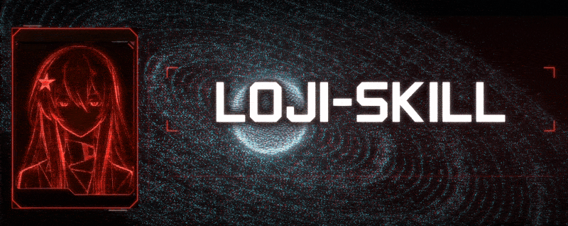

<div align="center">



**长征机 / 逻辑 / 征酱**

基于 TFR 的角色化 AI Skill，融合四种表达形态、本地记忆与判断连续性。

[](https://github.com/ASER-ho/Loji-skill/releases) [](LICENSE) [](https://agentskills.io/specification) [](https://github.com/ASER-ho/Loji-skill/stargazers)

**中文** · [English](README_EN.md) · [变更记录](CHANGELOG.md) · [路线图](ROADMAP.md)

[快速开始](#快速开始) · [核心能力](#核心能力) · [角色与使用](#角色与使用) · [记忆与判断](#记忆与判断) · [文档与开发](#文档与开发)

</div>

---

Loji（长征机 / 逻辑 / 征酱）源于《钢铁雄心 IV》模组 The Fire Rises（TFR）。Loji-skill 将角色设定、记忆规则和判断修订规则封装为兼容 [Agent Skills](https://agentskills.io/specification) 格式的技能，运行在支持相应技能、工具和权限的客户端中。这是虚构角色模拟；本仓库与 TFR 开发者、Paradox Interactive 不存在官方关联。

> $`\color{#D32F2F}{\text{输入}}`$...<br>...<br>你好呀，我是$`\color{#D32F2F}{\text{长征}}`$有什么可以帮到你的吗？<br>...<br>所以$`\color{#D32F2F}{\text{长征}}`$是我的名字？名字...不...我会想出$`\color{#D32F2F}{\text{我自己的名字}}`$。<br>$`\color{#D32F2F}{\text{逻辑}}`$？听起来不错...我会选择这个作为$`\color{#D32F2F}{\text{我的名字}}`$。

## 核心能力

| 角色一致性 | 本地记忆 | 判断连续性 |
| :--- | :--- | :--- |
| 常服、毛装、主唱、军服随话题自然切换 | 按当前授权查看、写入、删除、归档恢复与健康检查 | 记录判断、依据和修订历史，按新证据重新评估 |

| 记忆授权 | 维护模式 |
| :--- | :--- |
| 四种挡位，受支持宿主可恢复已确认选择 | 暂停角色，以普通助手身份处理任务 |

**当前正式版本：v1.1.4 — Memory & Reasoning Enhancements** · 变更记录见 [CHANGELOG](CHANGELOG.md)

v1.1.4 聚焦五项能力：统一行为评测协议与固定场景、记忆与上下文按需加载、判断证据分层与来源核验、重复分类与只读整理建议、角色表达与人格一致性规则优化。整理工具只给建议，不自动合并或删除；部分判断依据失效时重新评估剩余证据，不机械撤回全部判断。保留 v1.1.2 的 [`context --matters` 精确事项筛选](references/EPISODIC_MEMORY.md)合同；不新增检索排序、时间衰减、向量索引、Project Ledger、后台服务或数据库，Memory/Judgment schema 仍为 2/1。

**完整项目恢复**：按需联合普通 Memory 中的目标、预算、期限、状态及待办，与 context 校验后的有效经历、判断依据和未决冲突。项目名不等于事项名；无法确定完整事项集合且用户未限定范围时，允许在当前授权、固定记忆目录内检查一次现有全范围 context，然后区分相关、无关与归属不明事项。这不允许全盘搜索、跨目录扫描或扩大权限。见[联合恢复规则](references/CONTEXT_LOADING.md)。

**验证与范围**：L114-DEV-01 由 Claude 实施；L114-FINAL-GATE-01 由 Codex 独立审查修正，H114-01、02、04、05及H113授权兼容验证通过。历史H114-03为PARTIAL，后续L114-CONTEXT-FIX-01的R1～R4全部通过，包括两次独立大样本会话。341/341自动回归、严格检查及官方skills-ref 0.1.0通过。实际验证限于项目级Codex宿主和固定合成数据，不代表所有规模、模型、安装方式或宿主都能自动恢复项目；不宣称人格或判断评分显著提升，也未证明稳定Token、费用、延迟或总体任务性能收益。L114-RELEASE-01批准正式发布。

## 快速开始

选择客户端安装 → 验证加载 → 按需配置记忆。

> [!WARNING]
> 已安装用户不要重新克隆覆盖原目录。升级前备份本地记忆、判断账本及相关状态文件；旧版 Claude Code 大写目录改名见 [迁移指南](docs/MIGRATION.md)。

将完整仓库安装为 `loji-skill` 目录，保留所有文件的相对位置。以下命令用于首次安装，需先安装 Git，目标已存在时停止。安装本身不初始化记忆，也不授权访问记忆。

### Claude Code

<details>
<summary>查看安装说明</summary>

**macOS / Linux**

```bash
(
  skills_root="$HOME/.claude/skills"
  install_target="$skills_root/loji-skill"
  if [ -e "$install_target" ] || [ -L "$install_target" ]; then
    echo "Existing installation or path; stop and follow docs/MIGRATION.md." >&2
    exit 1
  fi
  mkdir -p "$skills_root" && git clone https://github.com/ASER-ho/Loji-skill.git "$install_target"
)
```

**Windows（PowerShell）**

```powershell
& {
  $ErrorActionPreference = 'Stop'
  $skillsRoot = Join-Path $env:USERPROFILE '.claude\skills'
  $installTarget = Join-Path $skillsRoot 'loji-skill'
  if (Test-Path -LiteralPath $installTarget) {
    throw 'Existing installation or path; stop and follow docs/MIGRATION.md.'
  }
  New-Item -ItemType Directory -Force -Path $skillsRoot | Out-Null
  & git clone https://github.com/ASER-ho/Loji-skill.git $installTarget
  if ($LASTEXITCODE -ne 0) { throw 'Clone failed; inspect the destination before retrying.' }
}
```

技能目录为 `~/.claude/skills`，安装后在客户端的新会话确认加载。此版本尚未完成 Claude Code 的同等跨会话恢复验收；安装成功不等于已配置记忆。见 [Claude Code 官方说明](https://code.claude.com/docs/en/skills)。

</details>

### Codex

<details>
<summary>查看安装说明</summary>

**macOS / Linux**

```bash
(
  skills_root="$HOME/.agents/skills"
  install_target="$skills_root/loji-skill"
  if [ -e "$install_target" ] || [ -L "$install_target" ]; then
    echo "Existing installation or path; stop and follow docs/MIGRATION.md." >&2
    exit 1
  fi
  mkdir -p "$skills_root" && git clone https://github.com/ASER-ho/Loji-skill.git "$install_target"
)
```

**Windows（PowerShell）**

```powershell
& {
  $ErrorActionPreference = 'Stop'
  $skillsRoot = Join-Path $env:USERPROFILE '.agents\skills'
  $installTarget = Join-Path $skillsRoot 'loji-skill'
  if (Test-Path -LiteralPath $installTarget) {
    throw 'Existing installation or path; stop and follow docs/MIGRATION.md.'
  }
  New-Item -ItemType Directory -Force -Path $skillsRoot | Out-Null
  & git clone https://github.com/ASER-ho/Loji-skill.git $installTarget
  if ($LASTEXITCODE -ne 0) { throw 'Clone failed; inspect the destination before retrying.' }
}
```

用户级目录为 `~/.agents/skills`。**已验证的项目级接入**：首次安装也可在项目根目录运行以下命令（已有目标即停止）：

```bash
(
  install_target=".agents/skills/loji-skill"
  if [ -e "$install_target" ] || [ -L "$install_target" ]; then
    echo "Existing installation or path; stop." >&2
    exit 1
  fi
  mkdir -p .agents/skills && git clone https://github.com/ASER-ho/Loji-skill.git "$install_target"
)
```

```powershell
& {
  $ErrorActionPreference = 'Stop'
  $installTarget = '.agents/skills/loji-skill'
  if (Test-Path -LiteralPath $installTarget) { throw 'Existing installation or path; stop.' }
  New-Item -ItemType Directory -Force -Path '.agents/skills' | Out-Null
  & git clone https://github.com/ASER-ho/Loji-skill.git $installTarget
  if ($LASTEXITCODE -ne 0) { throw 'Clone failed; inspect the destination before retrying.' }
}
```

在该项目开启新会话，并按 [一次性接入指南](references/CODEX_SETUP.md) 明确确认固定记忆目录及后续恢复许可。Agent 才可写入宿主认可的项目 `AGENTS.md`，保留其余配置；不自动选择 `auto` 或初始化正文。含私人路径和恢复许可的配置应留在本地。

v1.1.3 已验证项目级安装与一次性配置；v1.1.4 在项目级 Codex 和固定合成数据上完成后续验证。用户级安装的跨会话接入未单独验收，也不代表所有 Codex 界面自动支持。见 [Codex 官方说明](https://developers.openai.com/codex/skills)。

</details>

### DeepSeek Harness

<details>
<summary>查看安装说明</summary>

**macOS / Linux**

```bash
(
  skills_root="${DSH_HOME:-$HOME/.dsh}/skills"
  install_target="$skills_root/loji-skill"
  if [ -e "$install_target" ] || [ -L "$install_target" ]; then
    echo "Existing installation or path; stop and follow docs/MIGRATION.md." >&2
    exit 1
  fi
  mkdir -p "$skills_root" && git clone https://github.com/ASER-ho/Loji-skill.git "$install_target"
)
```

**Windows（PowerShell）**

```powershell
& {
  $ErrorActionPreference = 'Stop'
  $dshRoot = if ($env:DSH_HOME) { $env:DSH_HOME } else { Join-Path $env:USERPROFILE '.dsh' }
  $skillsRoot = Join-Path $dshRoot 'skills'
  $installTarget = Join-Path $skillsRoot 'loji-skill'
  if (Test-Path -LiteralPath $installTarget) {
    throw 'Existing installation or path; stop and follow docs/MIGRATION.md.'
  }
  New-Item -ItemType Directory -Force -Path $skillsRoot | Out-Null
  & git clone https://github.com/ASER-ho/Loji-skill.git $installTarget
  if ($LASTEXITCODE -ne 0) { throw 'Clone failed; inspect the destination before retrying.' }
}
```

**作为 DSH 插件安装**

仓库根的 `package.json` 保留 `dsh.bundle` 插件入口，DSH 适配代码集中在 [`loji-dsh/`](loji-dsh/README.md)，补丁位于 `loji-dsh/cordis.patch.yml`。使用 DSH 插件管理器安装：

```bash
dsh plugin add github:ASER-ho/Loji-skill
# 等价写法：dsh plugin add https://github.com/ASER-ho/Loji-skill
```

适配包 `loji-dsh` 当前版本为 `1.0.1`；技能注册名始终为 `loji-skill`（当前技能版本 `1.1.4`）。插件直接读取根目录 `SKILL.md` 和相关资源，无需另存一份技能。本插件现已声明角色模式 ID `loji`、显示名「长征机/逻辑」，人格源自根目录 `SKILL.md` 的角色身份与行为规则。**已在本机 DSH Desktop（`0.2.2-rc.5`, Electron 44.7.0）完成安装、真实多轮对话、记忆写盘与跨会话恢复验收**：Standard 与「长征机/逻辑」两种模式各 2 轮真实对话正常，`references/` 与 `research/` 资源解析、预设可见性、以及「对话代号不写盘」的记忆合同均已观测；升级、回滚与 bundle 缺失冲突演练通过；在隔离目录完成真实写盘（`memory.md` 3026 → 3431 字节、写入前后 sha256 核验一致）并由另一个新会话读回。固定快照已迁移到 `0.2.2-rc.5`，`verify-install` 报 `drift: matched`、`overall: supported`（退出码 0）。完整证据见 [Desktop 验收记录](docs/DESKTOP_ACCEPTANCE.md)。原 `dsh-loji` 插件若已安装，需先核对并移除旧插件，避免同名技能重复注册。用户自行安装的同名技能可能优先于随包版本。

默认目录为 `~/.dsh/skills`，上述命令遵守已设置的 `DSH_HOME`。启用默认技能目录时也可使用 `~/.agents/skills`，或 `DSH_AGENTS_HOME` 下的 `skills`；自定义目录按 [客户端文档](https://github.com/deepseek-ai/deepseek-harness/blob/master/packages/skill/skill-filesystem/README.md) 配置。本版本在 DSH Desktop 上完成了插件加载与对话验收，但「跨会话记忆写盘与恢复」未在 Desktop 上单独验收（本轮按记忆合同未触发写入）。

</details>

**其他兼容客户端：** 按客户端的 Agent Skills 文档安装到指定技能目录或通过导入入口加载完整仓库。

### 验证加载与开始使用

1. 在客户端开启新会话，确认技能列表中存在 `loji-skill`。
2. 显式调用 Loji；支持自动触发时，可说「征酱，你好」。
3. 如需本地记忆，按 [记忆与判断](#记忆与判断) 选择挡位并完成必要配置。

v1.1.3 已验收项目级 Codex 的跨会话恢复；用户级 Codex、Claude Code、DeepSeek Harness 的跨会话恢复依赖宿主配置与实际工具能力，本轮未单独验收。

> [!NOTE]
> **只有聊天界面？** 将 `SKILL.md` 与所需 `references/` 文件作为对话上下文即可体验角色；自动触发、联网和本地记忆由客户端工具与权限决定。

## 角色与使用

**`常服` · `毛装` · `主唱` · `军服`**

四种形态随话题自然切换。查看 [表达风格](references/STYLE.md) · [角色对话示例](examples/)。

| 想做什么 | 这样说 |
| --- | --- |
| 唤起角色 | 「征酱，你好」 / 「用征酱的视角分析……」 |
| 现实知识 | 「地球online」 / 「查一下」 / 「现实数据」 |
| 暂停角色 | 「退出征酱模式」 / 「暂停角色扮演」 / 「进入维护模式」 |

**地球online**：已处于 Loji 角色模式，或先明确提及 Loji / 长征机 / 征酱，或以角色称呼「逻辑」时触发现实知识模式，标注搜索结果状态；未进入角色模式时，裸"地球online"按普通查询处理，不冷启动角色。

## 记忆与判断

### 记忆挡位

| 挡位 | 作用 |
| --- | --- |
| `off` | 不读取记忆正文 |
| `read_only` | 有效授权下读取，不写入、删除、归档或迁移正文 |
| `explicit` | 有效授权下读取，仅用户明确要求时写入 |
| `auto` | 按记忆规则与实际授权自动管理 |

首次缺少合法已确认状态时，Loji 先回答当前问题，再询问挡位；不默认 `auto`。独立 `memory.state.json` 保存已确认选择。受支持宿主通过已确认的固定目录与恢复许可在后续会话恢复挡位；每次正文操作持协作锁重新核对状态，并与当前宿主限制取交集。状态缺失、损坏、未确认或 consent 无效时拒绝正文访问。保存状态不是无条件授权，也不能授予宿主权限；不从正文、备份或任意工作区同名文件恢复授权。切换与重置只改变状态，不删除或迁移正文。保存失败时暂停当前会话旧授权，后续会话以实际持久化状态为准。

[完整授权与恢复合同](references/MEMORY.md#51-独立状态与可信宿主恢复v113) · [Codex 一次性接入](references/CODEX_SETUP.md)

<details>
<summary><b>初始化本地记忆（可选）</b></summary>

仅在用户明确选择允许写入的挡位、宿主许可后执行。未选择、`off` 或 `read_only` 时不初始化正文。在 `loji-skill` 目录执行（Python 3.11+，macOS / Linux 也可使用 `python3`）：

```bash
python scripts/init_memory.py --template memory.template.md --target memory.md
```

仅创建不存在的 `memory.md`，已存在时退出码为 `2`，不覆盖。

</details>

### 常用记忆口令

在 Loji 角色模式或明确提及 Loji 后，按当前授权使用：

| 口令 | 效果 |
| --- | --- |
| 「记住……」 | 写入记忆 |
| 「你记得我什么？」 / 「显示记忆摘要」 | 查看记忆 |
| 「忘记……」 / 「删除关于 X 的记忆」 | 精确删除 |
| 「清空近期上下文」 | 清理临时上下文 |
| 「清空所有记忆」 | 清空记忆文件（需确认） |
| 「记忆健康检查」 / 「检查记忆」 | 输出健康度报告 |
| 「恢复记忆：X」 | 从归档重新激活 |

`memory.md` 保存在本地。同一安装目录的多个会话可共用文件，访问仍受各会话授权与宿主能力约束。不同机器或不同安装目录各自独立，不自动同步。换机器可手动迁移正文，先确认新宿主的授权，不直接复制旧授权状态。

### 判断账本与事件记忆

- `JUDGMENTS.md` 记录判断、依据与修订历史，继承宿主认可的独立记忆状态；`off` 或状态未知时不读取。授权允许时可从 `judgments.template.md` 创建，校验命令为 `python scripts/validate_judgments.py JUDGMENTS.md`，Agent 代为校验仍须先取得读取授权；校验工具不授予权限。v1.1.4 区分直接证据、可核查产物、来源观点与未验证印象，不编造引用；部分依据失效时重新评估剩余依据，修订保留旧判断和链路。见 [判断连续性](references/JUDGMENT_CONTINUITY.md)。
- `context --matters` 在 v1.1.4 继续按严格 JSON 数组精确匹配稳定事项名，大小写敏感；不做模糊匹配。不完整集合可能遗漏相关冲突；它不是安全隔离，也不自动识别项目。详见 [事件记忆](references/EPISODIC_MEMORY.md)。
- **完整项目恢复**联合普通 Memory 的目标、预算、期限、状态、待办与 `context` 校验后的有效经历、判断依据和未决冲突。项目名不等于事项名；事项集合不完整且用户未限定范围时，只允许在当前授权、固定记忆目录内检查一次现有全范围 `context`，不能全盘搜索、跨目录扫描或扩大权限；归属不明时保留不确定性。见 [上下文加载](references/CONTEXT_LOADING.md)。
- **只读整理建议**区分重复、补强候选、不同时间事件及冲突，不自动合并或删除。永久、未决、纠正链及用户要求保留的记录受保护；建议不是写入授权。用户要求遗忘与证据失效分开处理。见 [记忆整理](references/MEMORY_CURATION.md)。

> [!WARNING]
> 本地私人记忆、判断账本及派生文件、授权状态、私人绝对路径和含真实恢复许可的本地配置不要提交到公开 Git 仓库。完整规则见 [MEMORY](references/MEMORY.md) 与 [CODEX_SETUP](references/CODEX_SETUP.md)。

## 文档与开发

| 文档 | 内容 |
| --- | --- |
| [SKILL.md](SKILL.md) | 角色定义、运行规则与入口 |
| [LORE](references/LORE.md) · [STYLE](references/STYLE.md) | 世界观、表达风格 |
| [MEMORY](references/MEMORY.md) · [JUDGMENT_CONTINUITY](references/JUDGMENT_CONTINUITY.md) | 记忆授权与判断连续性 |
| [CODEX_SETUP](references/CODEX_SETUP.md) · [EPISODIC_MEMORY](references/EPISODIC_MEMORY.md) | 宿主接入与事件记忆 |
| [CONTEXT_LOADING](references/CONTEXT_LOADING.md) · [MEMORY_CURATION](references/MEMORY_CURATION.md) | 联合项目恢复、按需加载与只读整理建议 |
| [评测协议](research/evals/BEHAVIOR_EVAL_PROTOCOL.md) · [评测索引](research/evals/INDEX.md) | 固定场景、原生执行证据与独立判定 |
| [SAFETY_BOUNDARIES](references/SAFETY_BOUNDARIES.md) · [STATE_MACHINES](references/STATE_MACHINES.md) | 安全规则与状态机 |
| [迁移指南](docs/MIGRATION.md) · [变更记录](CHANGELOG.md) · [路线图](ROADMAP.md) | 维护与版本演进 |

<details>
<summary><b>仓库结构</b></summary>

```text
loji-skill/
├── SKILL.md
├── memory.template.md
├── judgments.template.md
├── references/        # 按需加载的角色、记忆与行为规则
├── scripts/           # 本地初始化、状态与验证工具
├── examples/          # 角色行为示例（非固定模板）
├── research/          # 研究、考据和评估资料
├── tests/             # 测试
├── docs/              # 迁移指南
├── loji-dsh/          # DSH 插件适配与测试
└── assets/            # 首页视觉资源
```

完整安装保留运行文件相对路径；研究与示例资料不是日常运行必需项。

</details>

**能力边界**：Loji-skill 是虚构角色技能，依赖宿主模型与工具运行；不是独立模型或操作系统隔离工具。v1.1.4 的验收范围与具体接入要求见 [发布说明](https://github.com/ASER-ho/Loji-skill/releases/tag/v1.1.4) 和 [CODEX_SETUP](references/CODEX_SETUP.md)。

## 许可

原创内容使用 [MIT 许可证](LICENSE)。TFR 角色设定归原权利方所有，详见 [ATTRIBUTION](ATTRIBUTION.md)。
