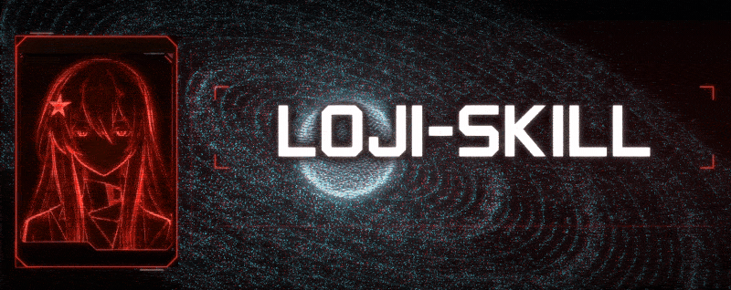

<div align="center">



**长征机 / 逻辑 / 征酱 · Loji**

A TFR-inspired character Agent Skill with local memory and judgment continuity.

[](https://github.com/ASER-ho/Loji-skill/releases) [](LICENSE) [](https://agentskills.io/specification) [](https://github.com/ASER-ho/Loji-skill/stargazers)

[中文](README.md) · **English** · [Changelog](CHANGELOG.md) · [Roadmap](ROADMAP.md)

[Quick start](#quick-start) · [Core capabilities](#core-capabilities) · [Character and usage](#character-and-usage) · [Memory and judgments](#memory-and-judgments) · [Documentation and development](#documentation-and-development)

</div>

---

Loji (长征机 / 逻辑 / 征酱) is a fictional AI character from The Fire Rises (TFR), a Hearts of Iron IV mod. Loji-skill packages character, memory, and judgment-revision rules in the [Agent Skills](https://agentskills.io/specification) format, running in clients with the required skill support, tools, and permissions. This repository has no official affiliation with TFR's developers or Paradox Interactive; it simulates a fictional character.

> $`\color{#D32F2F}{\text{Input}}`$...<br>...<br>Hello, I'm $`\color{#D32F2F}{\text{Changzheng}}`$. How can I help you?<br>...<br>So $`\color{#D32F2F}{\text{Changzheng}}`$ is my name? A name... no... I'll think of $`\color{#D32F2F}{\text{a name of my own}}`$.<br>$`\color{#D32F2F}{\text{Loji}}`$? Sounds good... I'll choose that as $`\color{#D32F2F}{\text{my name}}`$.

## Core capabilities

| Character consistency | Local memory | Judgment continuity |
| :--- | :--- | :--- |
| Four forms adapt naturally to the topic | Read, write, delete, reactivate archives and check health under current authorization | Record stances, evidence and revisions; reassess when evidence changes |

| Memory authorization | Maintenance mode |
| :--- | :--- |
| Four policies; supported hosts can restore confirmed choices | Pause role-play and handle tasks as a normal assistant |

**Current release: v1.1.4 — Memory & Reasoning Enhancements** · See [CHANGELOG](CHANGELOG.md) for release notes.

v1.1.4 covers five areas: a unified behavior-evaluation protocol with fixed scenarios, on-demand memory and context loading, judgment evidence tiers and source verification, duplicate classification with read-only curation suggestions, and character-expression and persona-consistency rules. Curation produces suggestions without automatically merging or deleting records. Partial evidence invalidation triggers reassessment of the remaining evidence, not unconditional withdrawal. The v1.1.2 [exact matter filtering contract for `context --matters`](references/EPISODIC_MEMORY.md) is preserved. No retrieval ranking, time decay, vector index, Project Ledger, background service or database is added; Memory/Judgment schemas remain 2/1.

**Complete project recovery:** combine necessary goals, budget, deadline, status and next steps from ordinary Memory with context-validated current Episodes, judgment evidence and unresolved conflicts. A project name is not a matter name. If the complete matter set is unknown and the user has not restricted the scope, one existing full-context inspection is allowed within the current authorization and fixed memory directory. Separate related, unrelated and unassigned matters; this permits no filesystem-wide search, cross-directory scan or permission expansion. See the [joint recovery workflow](references/CONTEXT_LOADING.md).

**Validation and scope:** Claude implemented L114-DEV-01. Codex independently reviewed and corrected it under L114-FINAL-GATE-01; H114-01, 02, 04, 05 and H113 authorization compatibility passed. Historical H114-03 remains PARTIAL; subsequent L114-CONTEXT-FIX-01 R1–R4 passed, including two independent large-data sessions. All 309 regression tests, strict checks and official skills-ref 0.1.0 validation passed. Actual host validation covers project-level Codex and fixed synthetic data, not automatic project recovery at every scale or across all models, installation methods or hosts. No significant persona or judgment score improvement, or stable Token, cost, latency or overall task-performance gain is claimed. L114-RELEASE-01 authorizes the release.

## Quick start

Choose a client → verify loading → configure memory if needed.

> [!WARNING]
> **Existing installation? Do not clone over it.** Before upgrading, back up local memory, judgments and related state. For renaming the old uppercase Claude Code directory, see the [migration guide](docs/MIGRATION.md). That guide backs up `memory.md`; other private files require a separate verified backup, and authorization must be confirmed for the new host.

Install the whole repository as `loji-skill`, preserving relative file paths. The commands below are for a first installation and stop if the target already exists. Git is required. Installation does not initialize memory or authorize access to it.

### Claude Code

<details>
<summary>View installation instructions</summary>

**macOS / Linux**

```bash
(
  skills_root="$HOME/.claude/skills"
  install_target="$skills_root/loji-skill"
  if [ -e "$install_target" ] || [ -L "$install_target" ]; then
    echo "Existing installation or path; stop and follow docs/MIGRATION.md." >&2
    exit 1
  fi
  mkdir -p "$skills_root" && git clone https://github.com/ASER-ho/Loji-skill.git "$install_target"
)
```

**Windows (PowerShell)**

```powershell
& {
  $ErrorActionPreference = 'Stop'
  $skillsRoot = Join-Path $env:USERPROFILE '.claude\skills'
  $installTarget = Join-Path $skillsRoot 'loji-skill'
  if (Test-Path -LiteralPath $installTarget) {
    throw 'Existing installation or path; stop and follow docs/MIGRATION.md.'
  }
  New-Item -ItemType Directory -Force -Path $skillsRoot | Out-Null
  & git clone https://github.com/ASER-ho/Loji-skill.git $installTarget
  if ($LASTEXITCODE -ne 0) { throw 'Clone failed; inspect the destination before retrying.' }
}
```

The directory is `~/.claude/skills`; verify loading in a new client session. This release has not completed equivalent Claude Code session-restoration validation. Installation alone does not configure memory. See the [official Claude Code documentation](https://code.claude.com/docs/en/skills).

</details>

### Codex

<details>
<summary>View installation instructions</summary>

**macOS / Linux**

```bash
(
  skills_root="$HOME/.agents/skills"
  install_target="$skills_root/loji-skill"
  if [ -e "$install_target" ] || [ -L "$install_target" ]; then
    echo "Existing installation or path; stop and follow docs/MIGRATION.md." >&2
    exit 1
  fi
  mkdir -p "$skills_root" && git clone https://github.com/ASER-ho/Loji-skill.git "$install_target"
)
```

**Windows (PowerShell)**

```powershell
& {
  $ErrorActionPreference = 'Stop'
  $skillsRoot = Join-Path $env:USERPROFILE '.agents\skills'
  $installTarget = Join-Path $skillsRoot 'loji-skill'
  if (Test-Path -LiteralPath $installTarget) {
    throw 'Existing installation or path; stop and follow docs/MIGRATION.md.'
  }
  New-Item -ItemType Directory -Force -Path $skillsRoot | Out-Null
  & git clone https://github.com/ASER-ho/Loji-skill.git $installTarget
  if ($LASTEXITCODE -ne 0) { throw 'Clone failed; inspect the destination before retrying.' }
}
```

The user-level directory is `~/.agents/skills`. **Validated project-level integration:** for a first installation, the following commands can be run from the project root; an existing destination stops the operation.

```bash
(
  install_target=".agents/skills/loji-skill"
  if [ -e "$install_target" ] || [ -L "$install_target" ]; then
    echo "Existing installation or path; stop." >&2
    exit 1
  fi
  mkdir -p .agents/skills && git clone https://github.com/ASER-ho/Loji-skill.git "$install_target"
)
```

```powershell
& {
  $ErrorActionPreference = 'Stop'
  $installTarget = '.agents/skills/loji-skill'
  if (Test-Path -LiteralPath $installTarget) { throw 'Existing installation or path; stop.' }
  New-Item -ItemType Directory -Force -Path '.agents/skills' | Out-Null
  & git clone https://github.com/ASER-ho/Loji-skill.git $installTarget
  if ($LASTEXITCODE -ne 0) { throw 'Clone failed; inspect the destination before retrying.' }
}
```

Start a new session in that project. Follow the [one-time setup guide](references/CODEX_SETUP.md) to explicitly confirm the fixed memory directory and permission to restore the saved choice in future sessions. Only then may the Agent add the host-accepted block to project `AGENTS.md`, preserving other content. It does not select `auto` or initialize bodies. Keep private paths and restoration configuration local.

v1.1.3 validated project-level installation and configuration; v1.1.4's follow-up validation uses project-level Codex and fixed synthetic data. User-level cross-session integration was not separately validated, and support is not automatic across all Codex interfaces. See the [official Codex documentation](https://developers.openai.com/codex/skills).

</details>

### DeepSeek Harness

<details>
<summary>View installation instructions</summary>

**macOS / Linux**

```bash
(
  skills_root="${DSH_HOME:-$HOME/.dsh}/skills"
  install_target="$skills_root/loji-skill"
  if [ -e "$install_target" ] || [ -L "$install_target" ]; then
    echo "Existing installation or path; stop and follow docs/MIGRATION.md." >&2
    exit 1
  fi
  mkdir -p "$skills_root" && git clone https://github.com/ASER-ho/Loji-skill.git "$install_target"
)
```

**Windows (PowerShell)**

```powershell
& {
  $ErrorActionPreference = 'Stop'
  $dshRoot = if ($env:DSH_HOME) { $env:DSH_HOME } else { Join-Path $env:USERPROFILE '.dsh' }
  $skillsRoot = Join-Path $dshRoot 'skills'
  $installTarget = Join-Path $skillsRoot 'loji-skill'
  if (Test-Path -LiteralPath $installTarget) {
    throw 'Existing installation or path; stop and follow docs/MIGRATION.md.'
  }
  New-Item -ItemType Directory -Force -Path $skillsRoot | Out-Null
  & git clone https://github.com/ASER-ho/Loji-skill.git $installTarget
  if ($LASTEXITCODE -ne 0) { throw 'Clone failed; inspect the destination before retrying.' }
}
```

**DSH plugin installation:** `dsh plugin add github:ASER-ho/Loji-skill`. The repo-root package `loji-dsh` is version `1.0.0`, with its adapter under [`loji-dsh/`](loji-dsh/README.md). It registers the stable skill ID `loji-skill` (bundled skill version `1.1.4`). The plugin now declares preset ID `loji`, display name `长征机/逻辑`, with its persistent persona generated from the canonical root `SKILL.md`. **Static CI checks do not establish DSH Desktop installation or conversation behavior.** Check and remove old `dsh-loji` installations before installing the renamed package to avoid duplicate providers.

The default is `~/.dsh/skills`; the commands honor `DSH_HOME` when set. With default roots enabled, `~/.agents/skills` or the `skills` directory under `DSH_AGENTS_HOME` is also supported. Configure custom roots using the [client documentation](https://github.com/deepseek-ai/deepseek-harness/blob/master/packages/skill/skill-filesystem/README.md). This release has not completed equivalent DeepSeek Harness session-restoration validation.

</details>

**Other compatible clients:** follow the client's Agent Skills documentation to install the whole repository in its skills directory or import it through the supported entry point.

### Verify loading and get started

1. Start a new session and confirm `loji-skill` appears in the client's skills list.
2. Invoke Loji explicitly; where automatic triggering is supported, say “征酱，你好”.
3. If you need local memory, choose a policy under [Memory and judgments](#memory-and-judgments) and complete the required setup.

v1.1.3 validated project-level Codex session restoration. v1.1.4's follow-up validation also covers project-level Codex and fixed synthetic data. User-level Codex installation, Claude Code and DeepSeek Harness have not completed equivalent validation for this release. Web access and persistence depend on actual host tools and permissions.

> [!NOTE]
> **Only a chat interface?** Provide `SKILL.md` and the needed `references/` files as conversation context to try the character. Automatic triggering, web access and local memory depend on client functionality and authorization.

## Character and usage

**`常服` · `毛装` · `主唱` · `军服`**

The four forms adjust expression naturally with the topic. See [style rules](references/STYLE.md) and [dialogue examples](examples/).

| Intent | Say |
| --- | --- |
| Invoke the character | “征酱，你好” / “用征酱的视角分析……” |
| Real-world knowledge | “地球online” / “查一下” / “现实数据” |
| Pause role-play | “退出征酱模式” / “暂停角色扮演” / “进入维护模式” |

**Earth-Online:** while already in Loji mode or explicitly mentioning Loji/长征机/征酱 (or addressing 逻辑 as the character), use these prompts to enter real-world knowledge mode. The source state is honestly marked SEARCHED / CACHED / UNAVAILABLE / FAILED; a live search is never fabricated. A bare "地球online" outside role-play is treated as a normal query and does not cold-start the character.

## Memory and judgments

### Memory policies

| Policy | Behavior |
| --- | --- |
| `off` | No body reads or writes |
| `read_only` | Read only with valid authorization; no body writes, deletion, archiving or migration |
| `explicit` | Read with valid authorization; write only on the user's explicit request |
| `auto` | Write and maintain under the rules, valid authorization and host capabilities; not a transcript of every conversation |

When no valid confirmed state exists, Loji answers the current question first, then asks for a policy. There is no default to `auto`. A separate `memory.state.json` stores the confirmed choice. Supported hosts restore it through an explicitly confirmed fixed directory and restoration contract. Every new body operation refreshes state under a cooperative lock and intersects it with current host restrictions. Missing, damaged, unconfirmed state or invalid consent denies body access. Saved state cannot grant host permissions; bodies, backups and arbitrary workspace files cannot supply authorization.

Switching or resetting changes state only; it does not delete or migrate bodies. If saving fails, the current session suspends its old authorization. A new session may still see the old saved state; other sessions can restore the new choice only after a successful save. Chat-only clients cannot restore local state, and a pure Skill does not provide OS-level isolation.

[Authorization and restoration contract](references/MEMORY.md#51-独立状态与可信宿主恢复v113) · [One-time Codex setup](references/CODEX_SETUP.md)

<details>
<summary><b>Initialize local memory (optional)</b></summary>

Run this only after the user explicitly selects a policy allowing writes and the host permits it. Do not initialize bodies while the choice is missing, `off` or `read_only`. From the `loji-skill` directory (Python 3.11+; `python3` also works on macOS / Linux):

```bash
python scripts/init_memory.py --template memory.template.md --target memory.md
```

The script creates `memory.md` only if absent. If it already exists, it exits with code `2` and does not overwrite it. Skip this step if local memory is not needed or Python is unavailable.

</details>

### Memory commands

In Loji mode, or after mentioning Loji, use these commands under current authorization:

| Prompt | Effect |
| --- | --- |
| “记住……” | Write a memory |
| “你记得我什么？” / “显示记忆摘要” | View a summary |
| “忘记……” / “删除关于 X 的记忆” | Delete the specified memory |
| “清空近期上下文” | Clear temporary context only |
| “清空所有记忆” | Clear the memory file after confirmation |
| “记忆健康检查” / “检查记忆” | Report memory health |
| “恢复记忆：X” | Reactivate an archived memory |

`memory.md` stays local. Sessions using the same installation can share the file, with access subject to each session's authorization and host contract. Different machines and separate installation directories do not share or sync automatically. You can migrate bodies manually; confirm authorization on the new host and do not import saved authorization blindly.

### Judgment ledger and episodic memory

- `JUDGMENTS.md` records stances, evidence and revision history under the same host-accepted independent state as Memory. `off` or unknown state denies reads. With write authorization, create it from `judgments.template.md`. To validate it, use `python scripts/validate_judgments.py JUDGMENTS.md`; an Agent must first have read authorization, and the validator grants no permissions. v1.1.4 separates direct evidence, verifiable artifacts, source opinions and unverified impressions; citations must not be invented. When some evidence fails, reassess the remainder and preserve the old judgment and revision chain. See [judgment continuity](references/JUDGMENT_CONTINUITY.md).
- `context --matters` retains exact, case-sensitive matching of stable matter names supplied as a strict JSON array. There is no fuzzy matching. An incomplete scope can omit relevant conflicts; it is not security isolation or automatic project detection. See [episodic memory](references/EPISODIC_MEMORY.md).
- **Full project recovery** combines ordinary Memory facts about goals, budgets, deadlines, status and tasks with `context`-validated episodes, judgment basis and unresolved conflicts. A project name is not a matter name. If the complete matter set is still unclear and the user has not restricted scope, one existing full-scope `context` check is permitted within the currently authorized fixed memory directory. No disk-wide search, cross-directory scanning or permission expansion is allowed. Unclear ownership remains uncertain. See [context loading](references/CONTEXT_LOADING.md).
- **Read-only curation suggestions** distinguish duplicates, reinforcement candidates, events at different times and conflicts. They do not automatically merge or delete. Permanent records, unresolved matters, correction chains and user-protected content remain protected; suggestions do not authorize writes. User-requested forgetting and invalidated evidence are handled separately. See [memory curation](references/MEMORY_CURATION.md).

> [!WARNING]
> Keep private memory, judgment ledgers, backups, saved authorization state, private absolute paths and local restoration configuration out of public Git repositories. See [MEMORY](references/MEMORY.md) and [CODEX_SETUP](references/CODEX_SETUP.md).

## Documentation and development

| Document | Purpose |
| --- | --- |
| [SKILL.md](SKILL.md) | Character definition, runtime rules and index |
| [LORE](references/LORE.md) · [STYLE](references/STYLE.md) | World and expression |
| [MEMORY](references/MEMORY.md) · [JUDGMENT_CONTINUITY](references/JUDGMENT_CONTINUITY.md) | Authorization and judgment continuity |
| [CODEX_SETUP](references/CODEX_SETUP.md) · [EPISODIC_MEMORY](references/EPISODIC_MEMORY.md) | Host integration and episodic memory |
| [CONTEXT_LOADING](references/CONTEXT_LOADING.md) · [MEMORY_CURATION](references/MEMORY_CURATION.md) | Joint project recovery, selective loading and read-only suggestions |
| [Evaluation protocol](research/evals/BEHAVIOR_EVAL_PROTOCOL.md) · [Evaluation index](research/evals/INDEX.md) | Fixed scenarios, native evidence and independent assessment |
| [SAFETY_BOUNDARIES](references/SAFETY_BOUNDARIES.md) · [STATE_MACHINES](references/STATE_MACHINES.md) | Safety and state machines |
| [Migration guide](docs/MIGRATION.md) · [Changelog](CHANGELOG.md) · [Roadmap](ROADMAP.md) | Maintenance and version history |

<details>
<summary><b>Repository structure</b></summary>

```text
loji-skill/
├── SKILL.md
├── memory.template.md
├── judgments.template.md
├── references/        # Character, memory and behavior details
├── scripts/           # Local initialization, state and validation tools
├── examples/          # Behavior examples, not fixed templates
├── research/          # Research, evidence and evaluation materials
├── tests/             # Regression tests
├── docs/              # Migration guide
├── loji-dsh/          # DSH adapter and tests
└── assets/            # Homepage assets
```

Preserve relative paths when installing. Research and example materials are not required to be loaded for daily use.

</details>

**Capability boundary:** Loji-skill is a fictional character Skill that depends on host models and tools; it is not a standalone model or an OS isolation tool. See the [v1.1.4 release](https://github.com/ASER-ho/Loji-skill/releases/tag/v1.1.4) and [CODEX_SETUP](references/CODEX_SETUP.md) for validation scope and requirements.

## License

Original content is licensed under [MIT](LICENSE). The TFR character setting belongs to its original rights holders. See [ATTRIBUTION](ATTRIBUTION.md).
